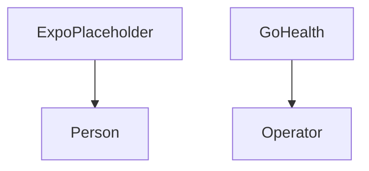

# Architecture

Status: target. Version 0.0.0 contains the directories below and no product behavior.

## Repository

```
apps/mobile          Expo client for Android, iOS, and web
services/api         Optional Go API
contracts/openapi    Versioned HTTP contracts
supabase/migrations  Optional cloud schema
e2e                  Playwright checks against the exported web app
docs                 Living design and ADRs
```

The Go API and Supabase are not on the local chat path. A person can complete a local session without either process running.

## Client

The Expo app owns the system of record once the local-store milestone lands:

- SQLite with SQLCipher for conversations, messages, memory, agent history, and settings.
- The app filesystem for attachments.
- A local vector index for memory retrieval.
- Operating-system secure storage for the database key and provider credentials.

Those stores are not implemented at version 0.0.0. The chat milestone starts with a SQLCipher spike. If that binding cannot ship, a new ADR replaces it before feature code depends on it.

## Model management

A Model Management System sits behind three settings: Auto, Best quality, and Private / Offline. It detects device capability, discovers runtimes, selects one, downloads and updates a curated model only after the user opts into offline AI, and watches inference performance.

The user never sees files, quantization, or hardware toggles. No model is bundled in the installer. If the device cannot run a local model, the product says so.

Each send builds a context package in memory: the new message, the recent turns that fit the window, and memory snippets already retrieved on the device. The archive stays in the database. The reply is written back locally, with the runtime id stored on the assistant message.

Frontier and custom calls go from the device to that provider. The Go API does not see the prompt. A future Frontal-brokered key would be a separate opt-in, because that path shows Frontal the context package.

## Agent runtime

Chat and agent work share one thread. The agent runtime plans, calls tools, reads local files, retrieves memory, records task history, and checks permissions. A frontier model may plan when cloud-inference consent is on. Private mode keeps the loop on the device. A tool may attach a local file only after the user allows that file for that run.

## Ports

Model, memory, and storage are ports. Local memory is the default adapter. Histeeria is a later cloud adapter and needs its own authorization, separate from sync and from cloud inference. Organization storage is a later trust domain.

## Optional cloud

`services/api` exposes versioned HTTP. Version 0.0.0 exposes `GET /v1/health` only. Supabase Postgres stores ciphertext for optional sync and holds account data when sign-in exists. Personal plaintext is not a cloud column.

## Current process



The placeholder renders the product name. The health route reports that the optional API process is up. Neither one stores or transmits personal data.
