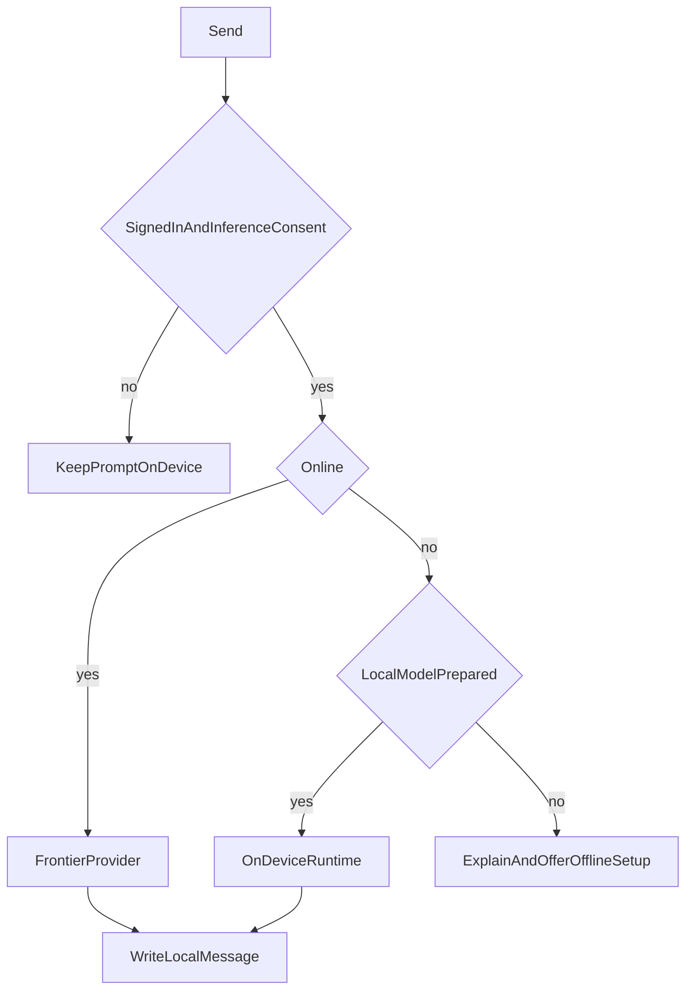

# Data flow

Status: the target flows are specified at port level. Version 0.0.0 does not execute them.

## Context package

On send, the client reads the local database and builds one package:

1. The new user message.
2. Recent turns that fit the model window.
3. Memory snippets already retrieved on the device.

The package is the only model input. The database file, the memory index, and unreferenced attachments stay on the device. The assistant message is written back into the same database and records which runtime answered.

## Auto

A guest in Auto or Best quality follows the left branch. Login is shown in the chat nav. The prompt is not sent.

When a device returns online, Auto may use a frontier model on a later turn if consent is already on. A turn that already has a local reply is not resent. A prompt that could not be answered offline is not queued for a silent cloud send.

## Private / Offline

The same package is handed to the on-device runtime and to nothing else, including when the network is available. If no runtime is prepared, or the device cannot run one, the client explains the limitation.

Offline preparation starts when the user turns Private / Offline on or accepts the offline offer. The manager uses an operating-system model where one exists, or downloads a curated model in the background. The installer does not contain a model.

## Best quality

Requires a signed-in session and cloud-inference consent. The package goes to a frontier provider. Sync is not involved.

## Cloud inference consent

This consent authorizes the context package for that turn. It does not authorize a backup. The request is device to provider.

## Optional sync

When the sync toggle is on, the client encrypts conversations, attachments, memory, and settings with a key the server does not have. Postgres stores ciphertext. Another device of the same user downloads ciphertext and decrypts it. The toggle defaults off and is independent of the intelligence mode.

## Histeeria

Cloud memory and evals use the memory port. The client sends personal memory only after a separate authorization. Sync and cloud inference do not imply it.

## Launch

Cold start shows the native splash, then the JS splash, then restores a session. No session goes to auth. A guest or signed-in session goes to settings. Guest never leaves the device. Google and email contact Supabase Auth only after the person uses those actions.

## Version 0.0.0

`GET /v1/health` returns `{"status":"ok"}` and reads no user data. Guest continues without a network call.
